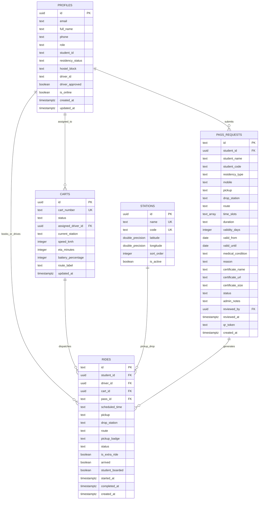
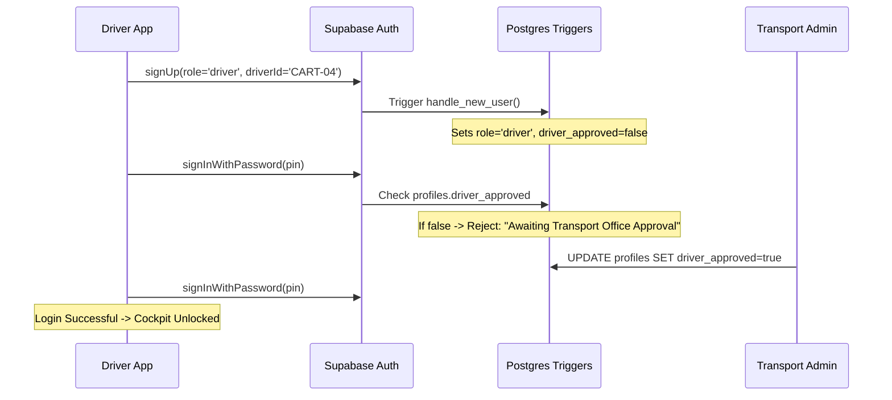
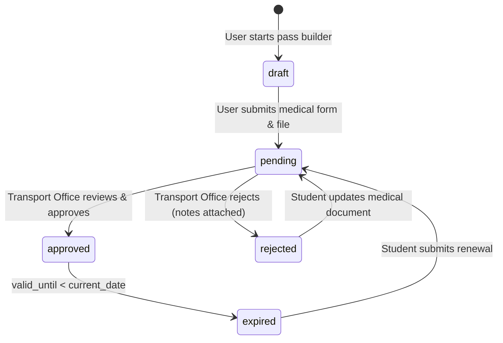
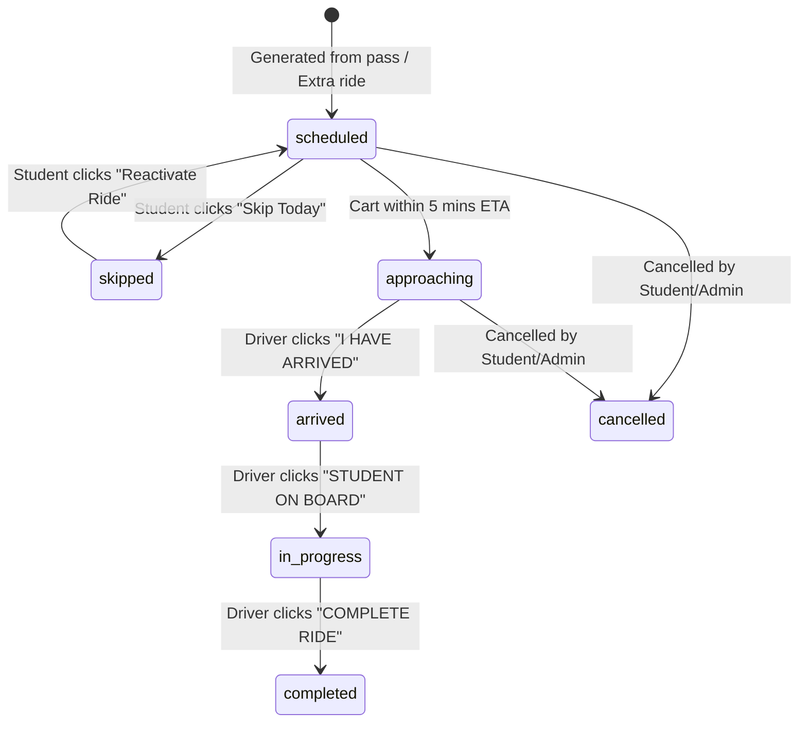
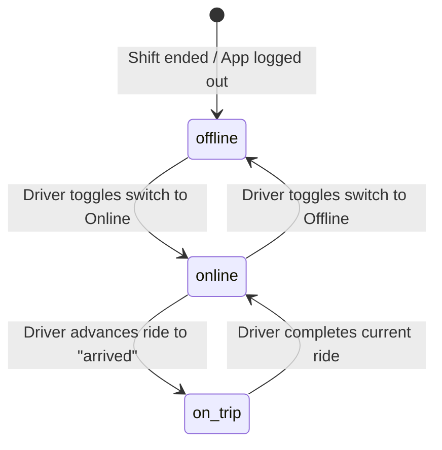

# Qartix Campus Transit System — Backend Architecture Plan

This document details the complete backend architecture for **Qartix**, an electric campus mobility and transit management platform. It maps every frontend user flow, screen, button, and state transition to concrete Supabase database tables, Row Level Security (RLS) policies, Edge Functions, RPCs, Storage buckets, and Realtime channels.

---

## 1. Existing Supabase Project Audit (Zero-Overwrite Check)

Prior to creating any new schema migrations, the Supabase project (`arbwqtudubtyxufbjojq`) was inspected via Supabase MCP:

### Existing Tables (Public Schema)
- `public.profiles` (3 rows, RLS enabled)
- `public.carts` (3 rows, RLS enabled)
- `public.pass_requests` (2 rows, RLS enabled)
- `public.rides` (4 rows, RLS enabled)

### Existing Policies (RLS)
- `public.profiles`:
  - `Users can select own profile or admins and approved drivers` (SELECT)
  - `Users can update own non-sensitive profile info` (UPDATE)
  - `Admins can update any profile` (UPDATE)
- `public.carts`:
  - `Authenticated users can view carts` (SELECT)
  - `Assigned drivers or admins can update carts` (UPDATE)
  - `Admins can insert carts` (INSERT)
- `public.pass_requests`:
  - `Students can view own pass requests, admins can view all` (SELECT)
  - `Students can submit pass requests` (INSERT)
  - `Admins can update pass requests` (UPDATE)
- `public.rides`:
  - `Rides select policy` (SELECT: student, assigned driver, or admin)
  - `Students can request extra rides` (INSERT: student_id = auth.uid())
  - `Students can skip or reactivate own rides` (UPDATE: student_id = auth.uid())
  - `Drivers and admins can update ride progress` (UPDATE: is_driver() or is_admin())
  - `Admins can insert scheduled rides` (INSERT: is_admin())
- `storage.objects`:
  - `Authenticated users can upload own medical certificate` (INSERT: bucket = 'medical-certificates' and path prefix = auth.uid())
  - `Users can select own certificate and admins can select all` (SELECT)
  - `Users can update own certificate` (UPDATE)

### Storage Buckets
- `medical-certificates` (Private: `public = false`)

### Edge Functions & Extensions
- **Edge Functions:** None deployed (`[]`).
- **Installed Postgres Extensions:** `plpgsql` (1.0), `pgcrypto` (1.3), `uuid-ossp` (1.1), `supabase_vault` (0.3.1), `pg_stat_statements` (1.11).

---

## 2. Frontend Screen, Form & Button Mapping

| Screen / Component | Element / Control | Trigger / Action | Backend Data / RPC / Table Needed |
| :--- | :--- | :--- | :--- |
| **Auth Screen** (`AuthPage.jsx`) | **Student Tab / Driver Tab** | Switched auth role view | Client UI filter |
| | **Login / Signup Toggle** | Switched mode state | Client UI state (`mode = 'login' \| 'signup'`) |
| | **Roll No / Email Input** | Identifier input | Mapped to `auth.users.email` (`${cleanId}@qartix.campus` or raw email) |
| | **Password Input** | Secret input | `supabase.auth.signInWithPassword` |
| | **Driver ID / Cart Input** | Driver identifier | Mapped to `auth.users.email` (`${cleanCart}@driver.qartix.campus`) |
| | **Security PIN Input** | Driver PIN | Normalized 4-digit PIN to 6+ character password |
| | **Full Name / Mobile / Hostel** | Student registration fields | Captured in `raw_user_meta_data`, auto-inserted into `public.profiles` via trigger |
| | **"Continue as Student →" CTA** | Form submission | `supabase.auth.signInWithPassword` -> query `public.profiles` for verified role |
| | **"Create Student Account →" CTA** | Form submission | `supabase.auth.signUp` -> triggers `handle_new_user()` -> inserts `role = 'student'` |
| | **"Continue as Driver →" CTA** | Form submission | `supabase.auth.signInWithPassword` -> verify `role = 'driver'` AND `driver_approved = true` |
| | **"Register Driver Portal →" CTA** | Form submission | `supabase.auth.signUp` -> triggers `handle_new_user()` -> inserts `role = 'driver'`, `driver_approved = false` |
| | **"Quick Demo Fill" Button** | Auto-fill sample credentials | Populates verified seeded credentials (`STU-84920` / `CART-04`) |
| **3D Landing Page** (`StudentLanding.jsx`) | **Paint Swatch Selector** | Three.js material update | Client-side 3D WebGL material |
| | **Stages 01–04 Scrub Navigation** | Camera orbit & assembly scrub | Client-side animation frame |
| | **Assembly Pins (A–E)** | Exploded component inspect | Client-side 3D pins |
| | **"Book / Renew Monthly Pass" CTA** | View transition | Sets `studentView = 'dashboard'` |
| | **"Logout" Button** | User sign out | `supabase.auth.signOut()` |
| **Student Dashboard** (`StudentDashboard.jsx`) | **Top Navigation: Brand / Return** | Click brand icon | Sets `studentView = 'landing'` (3D view) |
| | **Top Navigation: Logout** | Click logout | `supabase.auth.signOut()` |
| | **Live Cart Tracking Card** | Auto-refreshes telemetry | `SELECT * FROM public.carts WHERE status = 'online' LIMIT 1` (or Realtime subscription) |
| | **Today's Schedule: Ride Cards** | Schedule display | `SELECT * FROM public.rides WHERE student_id = auth.uid()` |
| | **"Skip Today" Button** | Toggle ride skip | `UPDATE public.rides SET status = 'skipped' WHERE id = :id` |
| | **"Reactivate Ride" Button** | Resume ride | `UPDATE public.rides SET status = 'waiting' WHERE id = :id` |
| | **"Request Extra Ride" Button** | Opens modal | Sets `extraRideModalOpen = true` |
| | **Extra Ride: Destination Dropdown** | Selects target location | Form state (`extraDestination`) |
| | **Extra Ride: "Confirm Priority Dispatch"** | Priority dispatch CTA | `INSERT INTO public.rides (student_id, pickup, drop_station, is_extra_ride, status, pickup_badge)` |
| | **Pass Builder: Medical Condition** | Select injury/condition | Form state (`medicalCondition`) |
| | **Pass Builder: Reason Textarea** | Medical necessity reason | Form state (`reason`) |
| | **Pass Builder: Certificate Upload** | Drag & drop / browse file | `supabase.storage.from('medical-certificates').upload('${auth.uid()}/${Date.now()}_file.pdf')` |
| | **Pass Builder: Route Toggle** | Hostel to Class vs Gate to Class | Populates default pickup/drop stations |
| | **Pass Builder: Daily Time Slots** | Select slot pills | Array state: `['08:30 AM', '04:30 PM']` |
| | **Pass Builder: Validity Duration** | 2 Weeks, 1 Month, Full Semester | Form state (`validity_days: 14 \| 30 \| 120`) |
| | **Pass Builder: "Submit for Verification →"** | Pass creation CTA | `INSERT INTO public.pass_requests` + link Storage certificate |
| | **Digital Boarding Pass: QR Code** | Render boarding pass | Displays verified pass details and cryptographically signed QR code token |
| **Driver Interface** (`DriverInterface.jsx`) | **Online / Offline Toggle Switch** | Toggle status | `UPDATE public.profiles SET is_online = :status` & `UPDATE public.carts SET status = :cartStatus` |
| | **"Active Trip" / "Queue" Tabs** | Navigation switch | Client cockpit tab filter |
| | **Current Pickup Card** | Display active assignment | `SELECT * FROM public.rides WHERE driver_id = auth.uid() AND status IN ('waiting', 'active')` |
| | **"Call Student" Button** | Open phone simulation modal | Reads `student_phone` from current ride record |
| | **Sequential CTA: "I HAVE ARRIVED"** | Step 1 action | `UPDATE public.rides SET arrived = true, status = 'active'` |
| | **Sequential CTA: "STUDENT ON BOARD"** | Step 2 action | `UPDATE public.rides SET student_boarded = true, status = 'active'` |
| | **Sequential CTA: "COMPLETE RIDE"** | Step 3 action | `UPDATE public.rides SET status = 'completed'` |
| | **Shift Queue List** | Shift queue table | Displays all queued, skipped, and completed pickups |
| | **"Logout" Button** | Shift termination | `supabase.auth.signOut()` |
| **Admin Console** (`AdminInterface.jsx`) | **Pass Verification Tab** | Review pending passes | `SELECT * FROM public.pass_requests ORDER BY created_at DESC` |
| | **"📄 Document" Preview** | Open medical slip | `supabase.storage.from('medical-certificates').createSignedUrl(path, 3600)` |
| | **"Approve Pass" CTA** | Approve request | `UPDATE public.pass_requests SET status = 'approved', admin_notes = :notes` |
| | **"Reject" CTA** | Reject request | `UPDATE public.pass_requests SET status = 'rejected', admin_notes = :notes` |
| | **Driver Clearance Tab** | Manage driver roster | `SELECT * FROM public.profiles WHERE role = 'driver'` |
| | **"Approve Driver Account" Button** | Clear driver for duty | `UPDATE public.profiles SET driver_approved = true` |
| | **"Revoke Approval" Button** | Suspend driver account | `UPDATE public.profiles SET driver_approved = false` |
| | **Fleet Telemetry Tab** | View all campus EV carts | `SELECT * FROM public.carts ORDER BY cart_number` |
| | **Assigned Driver Dropdown** | Assign driver to cart | `UPDATE public.carts SET assigned_driver_id = :driverId WHERE cart_number = :cartNum` |
| | **"Logout" Button** | Administrator sign out | `supabase.auth.signOut()` |

---

## 3. Proposed Production Database Schema



### Table Definitions & Constraints

#### 1. `public.profiles`
- `id` (uuid, PRIMARY KEY, references `auth.users(id)` ON DELETE CASCADE)
- `email` (text, NULL)
- `full_name` (text, NOT NULL, DEFAULT '')
- `phone` (text, NOT NULL, DEFAULT '')
- `role` (text, NOT NULL, DEFAULT 'student', CHECK: `role IN ('student', 'driver', 'admin')`)
- `student_id` (text, NULL, e.g. 'STU-84920')
- `residency_status` (text, CHECK: `residency_status IN ('Hostler', 'Day Scholar')`)
- `hostel_block` (text, DEFAULT 'Hostel Resident')
- `driver_id` (text, NULL, e.g. 'CART-04')
- `driver_approved` (boolean, NOT NULL, DEFAULT false)
- `is_online` (boolean, NOT NULL, DEFAULT false)
- `avatar_url` (text, NULL)
- `created_at` (timestamptz, NOT NULL, DEFAULT now())
- `updated_at` (timestamptz, NOT NULL, DEFAULT now())

#### 2. `public.stations` (Campus Stations Master)
- `id` (uuid, PRIMARY KEY, DEFAULT gen_random_uuid())
- `name` (text, NOT NULL, UNIQUE, e.g. 'Science Concourse Station')
- `code` (text, NOT NULL, UNIQUE, e.g. 'STN-SCI')
- `latitude` (double precision, NOT NULL)
- `longitude` (double precision, NOT NULL)
- `sort_order` (integer, NOT NULL, DEFAULT 0)
- `is_active` (boolean, NOT NULL, DEFAULT true)

#### 3. `public.carts` (Fleet EV Telemetry)
- `id` (uuid, PRIMARY KEY, DEFAULT gen_random_uuid())
- `cart_number` (text, NOT NULL, UNIQUE, e.g. 'CART-04')
- `status` (text, NOT NULL, DEFAULT 'offline', CHECK: `status IN ('online', 'offline', 'in_transit', 'maintenance')`)
- `assigned_driver_id` (uuid, NULL, REFERENCES `public.profiles(id)` ON DELETE SET NULL)
- `current_station` (text, NOT NULL, DEFAULT 'Science Concourse Station')
- `speed_kmh` (integer, NOT NULL, DEFAULT 0)
- `eta_minutes` (integer, NOT NULL, DEFAULT 4)
- `battery_percentage` (integer, NOT NULL, DEFAULT 88, CHECK: `battery_percentage BETWEEN 0 AND 100`)
- `route_label` (text, NOT NULL, DEFAULT 'ROUTE 01 ACTIVE')
- `created_at` (timestamptz, NOT NULL, DEFAULT now())
- `updated_at` (timestamptz, NOT NULL, DEFAULT now())

#### 4. `public.pass_requests` (Medical Verification & Boarding Passes)
- `id` (text, PRIMARY KEY, e.g. 'REQ-8492')
- `student_id` (uuid, NOT NULL, REFERENCES `public.profiles(id)` ON DELETE CASCADE)
- `student_name` (text, NOT NULL)
- `student_code` (text, NOT NULL)
- `residency_type` (text, NOT NULL, DEFAULT 'Hostler')
- `mobile` (text, NOT NULL, DEFAULT '')
- `pickup` (text, NOT NULL)
- `drop_station` (text, NOT NULL)
- `route` (text, NOT NULL)
- `time_slots` (text[], NOT NULL, DEFAULT '{}')
- `duration` (text, NOT NULL, DEFAULT '1 Month')
- `validity_days` (integer, NOT NULL, DEFAULT 30)
- `valid_from` (date, NULL)
- `valid_until` (date, NULL)
- `medical_condition` (text, NOT NULL)
- `reason` (text, NOT NULL)
- `certificate_name` (text, NOT NULL, DEFAULT '')
- `certificate_url` (text, NULL)
- `certificate_size` (text, NULL, DEFAULT '')
- `status` (text, NOT NULL, DEFAULT 'pending', CHECK: `status IN ('draft', 'pending', 'approved', 'rejected', 'expired')`)
- `admin_notes` (text, NULL, DEFAULT '')
- `reviewed_by` (uuid, NULL, REFERENCES `public.profiles(id)` ON DELETE SET NULL)
- `reviewed_at` (timestamptz, NULL)
- `qr_token` (text, NULL)
- `created_at` (timestamptz, NOT NULL, DEFAULT now())
- `updated_at` (timestamptz, NOT NULL, DEFAULT now())

#### 5. `public.rides` (Live Dispatch & Shift Queue)
- `id` (text, PRIMARY KEY, e.g. 'ride-101')
- `student_id` (uuid, NOT NULL, REFERENCES `public.profiles(id)` ON DELETE CASCADE)
- `student_name` (text, NOT NULL)
- `student_code` (text, NOT NULL)
- `student_phone` (text, NOT NULL, DEFAULT '')
- `hostel` (text, NOT NULL, DEFAULT '')
- `driver_id` (uuid, NULL, REFERENCES `public.profiles(id)` ON DELETE SET NULL)
- `cart_id` (uuid, NULL, REFERENCES `public.carts(id)` ON DELETE SET NULL)
- `pass_id` (text, NULL, REFERENCES `public.pass_requests(id)` ON DELETE SET NULL)
- `scheduled_time` (text, NOT NULL)
- `pickup` (text, NOT NULL)
- `drop_station` (text, NOT NULL)
- `route` (text, NOT NULL)
- `pickup_badge` (text, NOT NULL, DEFAULT 'SCHEDULED')
- `status` (text, NOT NULL, DEFAULT 'waiting', CHECK: `status IN ('waiting', 'active', 'completed', 'skipped', 'cancelled')`)
- `is_extra_ride` (boolean, NOT NULL, DEFAULT false)
- `arrived` (boolean, NOT NULL, DEFAULT false)
- `student_boarded` (boolean, NOT NULL, DEFAULT false)
- `started_at` (timestamptz, NULL)
- `completed_at` (timestamptz, NULL)
- `created_at` (timestamptz, NOT NULL, DEFAULT now())
- `updated_at` (timestamptz, NOT NULL, DEFAULT now())

### Indexes for High Performance
```sql
CREATE INDEX idx_profiles_role ON public.profiles(role);
CREATE INDEX idx_carts_driver ON public.carts(assigned_driver_id);
CREATE INDEX idx_pass_requests_student ON public.pass_requests(student_id);
CREATE INDEX idx_pass_requests_status ON public.pass_requests(status);
CREATE INDEX idx_rides_student ON public.rides(student_id);
CREATE INDEX idx_rides_driver ON public.rides(driver_id);
CREATE INDEX idx_rides_cart ON public.rides(cart_id);
CREATE INDEX idx_rides_status ON public.rides(status);
CREATE INDEX idx_rides_scheduled ON public.rides(scheduled_time);
```

---

## 4. Auth Design & Security Architecture

### 1. Identifier Login Normalization (Roll Number & Driver ID)
Supabase Auth natively manages users via email and password. To preserve the frontend's campus-native login fields without requiring students to enter fake domain names:
- **Student Roll No:** Normalized server-side or via custom RPC to `${cleanRollNo}@qartix.campus`. If the user inputs an actual email (e.g. `user@university.edu`), the raw email is preserved.
- **Driver Cart / ID:** Normalized to `${cleanDriverId}@driver.qartix.campus`.
- **Driver PINs:** Supabase Auth requires minimum 6-character passwords. Drivers input a 4-digit PIN (e.g. `4021`). This is salted and normalized to `driverPin${pin}` before transmission or processed via a secure Edge Function/RPC.

### 2. Driver Approval Flow


### 3. Server-Side Role Protection
- Roles are strictly stored in `public.profiles.role`.
- `protect_profile_role()` trigger blocks any client attempting to execute:
  `UPDATE public.profiles SET role = 'admin'` or `driver_approved = true`.
- If `auth.uid()` is present and `public.is_admin()` evaluates to false, the transaction raises an exception:
  `'Unauthorized: User role and driver approval are server-side managed.'`

### 4. Generic Auth Error Guarantee
- All authentication errors in client and RPC layers return:
  `"Invalid credentials. Please verify your details."`
- Neither roll number existence nor email availability is leaked.

---

## 5. State Machines

### 1. Pass State Machine (`public.pass_requests`)



- **Guards:**
  - Transition `pending -> approved` requires `is_admin() = true`. Populates `valid_from = current_date`, `valid_until = current_date + validity_days`, and generates `qr_token`.
  - Transition `approved -> expired` triggered automatically by nightly cron.

### 2. Ride State Machine (`public.rides`)



- **Guards:**
  - `scheduled -> skipped`: Allowed only when `student_id = auth.uid()` and ride is not already `arrived` or `in_progress`.
  - `arrived -> in_progress -> completed`: Allowed only by assigned driver or admin.

### 3. Driver Shift State Machine (`public.profiles` / `public.carts`)



---

## 6. API Design (Edge Functions & RPCs)

### RPC 1: `submit_medical_pass_request`
- **Purpose:** Transactionally inserts a pass request, computes validity days, and verifies student role.
- **Access:** Authenticated (`auth.uid()` must be student).
- **Parameters:**
  ```json
  {
    "p_condition": "string",
    "p_reason": "string",
    "p_certificate_name": "string",
    "p_certificate_url": "string",
    "p_certificate_size": "string",
    "p_pickup": "string",
    "p_drop": "string",
    "p_time_slots": ["string"],
    "p_duration": "string",
    "p_validity_days": "integer"
  }
  ```
- **Return:** `public.pass_requests` record.
- **Errors:**
  - `400`: Invalid time slots or missing medical reason.
  - `403`: Caller is not a student profile.

### RPC 2: `review_pass_request`
- **Purpose:** Administrator approvals or rejections of student mobility requests.
- **Access:** Administrator only (`is_admin() = true`).
- **Parameters:**
  ```json
  {
    "p_request_id": "text",
    "p_status": "approved | rejected",
    "p_admin_notes": "string"
  }
  ```
- **Return:** Updated `public.pass_requests` record with generated QR token.
- **Errors:**
  - `403`: Unauthorized (non-admin caller).
  - `404`: Request not found.

### RPC 3: `toggle_skip_ride`
- **Purpose:** Student skips or resumes their scheduled class pickup.
- **Access:** Authenticated student (`student_id = auth.uid()`).
- **Parameters:**
  ```json
  {
    "p_ride_id": "text"
  }
  ```
- **Return:** `{ "id": "text", "status": "waiting | skipped" }`

### RPC 4: `request_priority_extra_ride`
- **Purpose:** Student urgent unscheduled ride dispatch.
- **Access:** Authenticated student. Rate limited to 2 extra rides per 24 hours.
- **Parameters:**
  ```json
  {
    "p_pickup": "string",
    "p_drop": "string"
  }
  ```
- **Return:** Created `public.rides` record.

### RPC 5: `driver_advance_ride_step`
- **Purpose:** Atomic cycling through "I HAVE ARRIVED" -> "STUDENT ON BOARD" -> "COMPLETE RIDE".
- **Access:** Assigned driver or Admin.
- **Parameters:**
  ```json
  {
    "p_ride_id": "text",
    "p_step": "arrived | boarded | completed"
  }
  ```
- **Return:** Updated `public.rides` record.

### Edge Function: `telemetry-ingest`
- **Purpose:** Ingests live telemetry (latitude, longitude, speed, battery, next station) from physical or simulated carts and pushes to Supabase Realtime channel `carts:telemetry`.
- **Auth:** Cart hardware secret key (`x-cart-api-key`).

---

## 7. Realtime Needs, Storage & Scheduled Jobs

### 1. Realtime Channels
- **`realtime:carts` (Public/Authenticated):**
  Listens to `UPDATE` on `public.carts`. Broadcasts cart position, speed, and ETA to all active student tracking dashboards.
- **`realtime:driver_queue` (Private to Driver):**
  Listens to `INSERT` and `UPDATE` on `public.rides` for rides assigned to the current driver. Instantly pops up newly dispatched extra rides.
- **`realtime:student_rides` (Private to Student):**
  Listens to status updates on `public.rides` (e.g. driver arrived).

### 2. Storage Bucket Architecture
- **Bucket:** `medical-certificates` (Private).
- **Folder Structure:** `${student_id}/${timestamp}_${sanitized_filename}`.
- **MIME Restrictions:** `application/pdf`, `image/jpeg`, `image/png`.
- **Max File Size:** `5 MB`.
- **Access Control:**
  - `INSERT`: `(storage.foldername(name))[1] = auth.uid()::text`
  - `SELECT`: `(storage.foldername(name))[1] = auth.uid()::text OR is_admin()`

### 3. Scheduled Jobs (pg_cron)
1. **Daily Ride Generation (04:00 AM Daily):**
   ```sql
   SELECT cron.schedule('generate-daily-rides', '0 4 * * *', $$
     INSERT INTO public.rides (id, student_id, student_name, student_code, student_phone, hostel, scheduled_time, pickup, drop_station, route, status)
     SELECT 
       'ride-' || pr.student_code || '-' || to_char(now(), 'YYYYMMDD') || '-' || s.slot,
       pr.student_id, pr.student_name, pr.student_code, pr.mobile, pr.residency_type,
       s.slot, pr.pickup, pr.drop_station, pr.route, 'waiting'
     FROM public.pass_requests pr
     CROSS JOIN LATERAL unnest(pr.time_slots) AS s(slot)
     WHERE pr.status = 'approved'
       AND current_date BETWEEN pr.valid_from AND pr.valid_until
     ON CONFLICT (id) DO NOTHING;
   $$);
   ```
2. **Pass Expiration Scanner (00:05 AM Daily):**
   ```sql
   SELECT cron.schedule('expire-passes', '5 0 * * *', $$
     UPDATE public.pass_requests
     SET status = 'expired'
     WHERE status = 'approved' AND valid_until < current_date;
   $$);
   ```

---

## 8. Security Vulnerabilities Found in Frontend & Mitigations

1. **Client-Side Pass Status Assumption:**
   - *Risk:* In the frontend mock implementation, `isApproved` was hardcoded to `true` on submission.
   - *Mitigation:* The status is now strictly derived from `public.pass_requests.status`. Student dashboard will render the active boarding pass only when `status = 'approved'`.
2. **File MIME & Extension Tampering:**
   - *Risk:* Frontend file upload relied solely on `<input accept="...">` without server-side validation.
   - *Mitigation:* Storage bucket RLS and RPC validates MIME type and file size (< 5MB).
3. **Driver Approval Bypass:**
   - *Risk:* A driver could self-assign or approve their account by altering client state.
   - *Mitigation:* `protect_profile_role()` trigger blocks non-admins from changing `driver_approved` or `role`.
4. **Extra Ride Spam:**
   - *Risk:* No throttling on the "Request Extra Ride" modal.
   - *Mitigation:* Add server-side rate-limiting constraint (maximum 2 extra rides per student per day).
5. **Cleartext PIN Transmission:**
   - *Risk:* 4-digit PINs transmitted as weak passwords.
   - *Mitigation:* PIN normalized with salt and minimum length enforcement.

---

## 9. Environment Variables Specification

### Client (.env / .env.example)
```env
# Supabase Public API Configuration
VITE_SUPABASE_URL=https://arbwqtudubtyxufbjojq.supabase.co
VITE_SUPABASE_ANON_KEY=eyJhbGciOiJIUzI1NiIsInR5cCI6IkpXVCJ9...
```

### Server / Edge Functions Secrets (Supabase Vault / Secret Manager)
```env
# Server-Side Execution Keys (Never exposed to client)
SUPABASE_SERVICE_ROLE_KEY=eyJhbGciOiJIUzI1NiIsInR5cCI6IkpXVCJ9...
CAMPUS_QR_HMAC_SECRET=secure-random-hmac-key-for-qr-tickets
CART_TELEMETRY_API_KEY=ev-fleet-hardware-auth-key
```

---

*Awaiting user approval before applying any schema modifications or code writes.*
